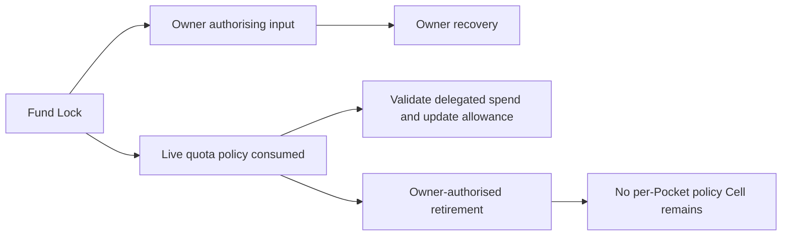

# QuotaCell and Metatype experiment

Can a CKB Pocket retire delegated authority while preserving the owner's ability to recover a late deposit? This experiment runs the public native QuotaCell profile, a conventional Lock/Type implementation, and a Metatype implementation in a disposable CKB devnet. It is experimental and unaudited.

| Profile | Policy after closure | Late recovery authority |
| --- | --- | --- |
| A · QuotaCell QCN4/QCT4 | Terminal QCT4 Cell | Owner Lock and a terminal policy transition |
| B · Conventional | Policy consumed | Owner Lock authenticated independently |
| C · Metatype | Policy consumed | Owner Lock authenticated independently |
| C+cap · Composition demonstration | Policy consumed | Same as C, with an additional independent payment rule while active |

B and C also allow the owner to withdraw protected native funds while a Pocket is active. A keeps recovery tied to its policy. The comparison matches the two-delegate payment and closure workload, with this deliberate behavioural difference. See [results, charts and test coverage](RESULTS.md) and the [security model](SECURITY.md).



## Reproduce

Use Rust 1.95.0, a RISC-V Rust target, Python 3, curl and a CKB 0.210.0 executable with the IntegrationTest and Experiment RPC modules. The Rust dependencies pin the public Metatype 0.1.0 source. Clone the same tag for its dispatcher and transaction tooling.

```sh
git clone --branch v0.1.0 https://github.com/a19q3/ckb-metatype.git ../ckb-metatype
rustup target add riscv64imac-unknown-none-elf
(cd ../ckb-metatype && tools/build-contracts.sh)
tools/build-contracts.sh
python3 -m venv .local/venv
.local/venv/bin/pip install -r ../ckb-metatype/tools/requirements.txt
.local/venv/bin/python tools/baseline.py .local/baseline
PYTHONPATH=../ckb-metatype/tools .local/venv/bin/python tools/compare.py \
    --ckb /path/to/ckb --metatype ../ckb-metatype --baseline .local/baseline \
    > .local/comparison.json
```

The baseline helper makes read-only requests for the exact published A, F and Q artifacts and checks SHA-256 against pinned values. Use `--rpc` for a different archive-capable testnet endpoint, or `--direct` if your HTTP proxy blocks these reads. The replay itself starts a loopback-only chain with fresh keys and a funded test genesis. The runner verifies accepted cases with `dry_run_transaction` and commits them in ordinary devnet blocks. Rejected transactions are dry-run only. There is no public-network transaction RPC in the replay.

[Raw results](evidence/comparison.json) record contract digests, cycle counts, transaction and witness sizes, errors, and locally committed transaction hashes. [Experiment build hashes](evidence/contracts.json) cover only first-party contracts in this repository. To regenerate the report and chart from a fresh run, install `matplotlib==3.10.8` in a Python environment that supports it, then run `python tools/report.py .local/comparison.json`.

## Sources and attribution

- QuotaCell revision `b3f488e47359361ea5d2549c152b8c0b418ebead`. The QCN4/QCT4 implementation and original test evidence are © 2026 Ticoworld and distributed under Apache-2.0. The replay fetches the deployed QCN4 ELF and the original proxy and always-success provider ELFs by digest. This repository ships the experiment's original reimplementation, builder and report under MIT. The upstream executables are fetched separately and retain their upstream terms. [QuotaCell source](https://github.com/Ticoworld/QuotaCell/tree/b3f488e47359361ea5d2549c152b8c0b418ebead) · [Upstream dependency notices](https://github.com/Ticoworld/QuotaCell/blob/b3f488e47359361ea5d2549c152b8c0b418ebead/docs/DEPENDENCIES.md)
- Metatype `v0.1.0`, commit `38bd969c3d374b1b1a77432b5de3a1d152af0368`. The experiment code, adapters and measurements live here. [Metatype release](https://github.com/a19q3/ckb-metatype/releases/tag/v0.1.0)
- CKB 0.210.0, commit `119598b0a1146a569068ac80bdba7eb5f6292fd3`. [CKB source](https://github.com/nervosnetwork/ckb/tree/119598b0a1146a569068ac80bdba7eb5f6292fd3)
