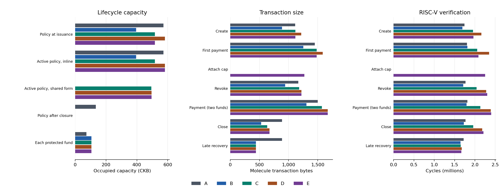

# Results v0.1.1

Profile E attached the cap on an existing Pocket after its first delegated payment, then completed further delegated payments and owner closure. A matched 62 CKB payment passed the verifier before attachment and failed afterwards. The same 61 CKB payment passed on both sides of attachment as a control.

The committed successor kept the physical Type hash, namespace, fund Lock, table hash and all quota state bytes. Shared usage stayed at 61 CKB and delegate usage at [61, 0] CKB. The policy outpoint and Manifest data hash changed. The Quota ELF remained byte for byte identical to the historical release.

## Occupied capacity

| CKB | A | B | C | D | E |
| --- | ---: | ---: | ---: | ---: | ---: |
| Policy at issuance | 572 | 395 | 517 | 582 | 517 |
| Active policy, inline | 572 | 395 | 517 | 582 | 582 |
| Active policy, shared form | — | — | 494 | 496 | 496 |
| Policy after closure | 134 | 0 | 0 | 0 | 0 |
| Each protected fund | 73 | 105 | 105 | 105 | 105 |
| Shared custom ELFs, table and definitions | 52,359 | 69,410 | 169,150 | 226,413 | 226,532 |

Attachment grew the same inline policy from 517 to 582 CKB occupied, an increase of 65 CKB. In this run every active policy held 600 CKB. Shared deployment costs include a 57,133 CKB code Cell for the new cap. D and E already deploy that code. E also stores the optional Quota-only shared definition. Common genesis secp code, data and dep group occupy 1,100,888 CKB and are omitted from custom deployment totals.

## Transactions

Each entry lists transaction bytes / witness payload bytes / verification cycles / Cell Deps / Header Deps. One secp dep-group entry resolves to its code and data Cells. All profiles use the same 183 CKB shared and individual limits, a 62 CKB quota ceiling per payment, and 61 CKB in each committed payment. D applies an additional 61 CKB cap from issuance and E applies it after attachment. C, D and E separately exercise both inline and shared encodings.

| Scenario | A | B | C | D | E |
| --- | ---: | ---: | ---: | ---: | ---: |
| Create | 1,114 / 97 / 1,745,803 / 4 / 0 | 888 / 85 / 1,693,296 / 3 / 0 | 1,116 / 85 / 1,952,333 / 5 / 1 | 1,218 / 85 / 2,161,682 / 6 / 1 | 1,116 / 85 / 1,965,954 / 5 / 1 |
| First payment | 1,448 / 97 / 1,804,698 / 4 / 0 | 1,254 / 85 / 1,816,064 / 3 / 0 | 1,482 / 85 / 2,057,412 / 5 / 1 | 1,584 / 85 / 2,351,486 / 6 / 1 | 1,482 / 85 / 2,087,433 / 5 / 1 |
| Attach cap | — | — | — | — | 1,270 / 85 / 2,251,320 / 6 / 1 |
| Revoke | 1,167 / 98 / 1,766,799 / 4 / 0 | 940 / 85 / 1,711,142 / 3 / 0 | 1,182 / 85 / 2,041,794 / 6 / 1 | 1,221 / 85 / 2,278,375 / 7 / 1 | 1,221 / 85 / 2,300,551 / 7 / 1 |
| Payment (two funds) | 1,500 / 97 / 1,815,930 / 4 / 0 | 1,306 / 85 / 1,793,930 / 3 / 0 | 1,571 / 85 / 2,135,979 / 6 / 1 | 1,673 / 85 / 2,390,309 / 7 / 1 | 1,673 / 85 / 2,398,363 / 7 / 1 |
| Close | 889 / 97 / 1,767,198 / 4 / 0 | 529 / 85 / 1,728,746 / 3 / 0 | 635 / 85 / 1,957,639 / 5 / 1 | 672 / 85 / 2,178,217 / 6 / 1 | 672 / 85 / 2,208,795 / 6 / 1 |
| Late recovery | 889 / 97 / 1,722,338 / 4 / 0 | 440 / 85 / 1,645,014 / 2 / 0 | 440 / 85 / 1,650,028 / 2 / 0 | 440 / 85 / 1,677,535 / 2 / 0 | 440 / 85 / 1,665,995 / 2 / 0 |

Profile E's paired 61 CKB dry runs measured 1,482 / 85 / 2,058,986 / 5 / 1 before attachment and 1,584 / 85 / 2,319,982 / 6 / 1 afterwards. The continuing cap added 102 transaction bytes, 1 Cell Dep and 260,996 measured cycles. The witness payload stayed at 85 bytes. Signatures differ between transactions and contribute to cycle variation.

## Payment interface variants

| Approach | Payment metrics in the order above | Occupied policy successor (CKB) |
| --- | ---: | ---: |
| Fixed positions | 1,584 / 85 / 2,351,486 / 6 / 1 | 582 |
| Successor-state references | 1,595 / 85 / 2,331,284 / 6 / 1 | 593 |
| Group Message references | 1,700 / 192 / 2,360,522 / 6 / 1 | 583 |

The two reference carriers rejected a claim using the actor's change as the payment. The witness mode also rejected an absent Group Message. Reordering outputs and providing matching references still failed the combined policy. The cap checked actual transaction roles in both modes, and the original quota validator retained its fixed positions. [Wire layout and responsibilities](PAYMENT-INTERFACE.md)

## Verification and limits

- **A** passed 10 committed cases, 1 positive dry run and 11 expected rejections.
- **B** passed 14 committed cases, 1 positive dry run and 11 expected rejections.
- **C** passed 14 committed cases, 2 positive dry runs and 12 expected rejections.
- **D** passed 14 committed cases, 2 positive dry runs and 14 expected rejections.
- **E** passed 15 committed cases, 4 positive dry runs and 16 expected rejections.

Each profile verifies the same delegate payment before and after revocation while sufficient shared and individual allowance remains. Shared exhaustion is a separate case using the still-enabled delegate. E additionally rejects attachment by a delegate, attachment with a quota-state change and removal while the policy survives. B–E recover late funds with independent owner authority and zero retained policy Capacity. Independent owner recovery permits withdrawal during the active phase.

The single quota Cell still serialises delegated spending. Attachment depends on an existing immutable table mapping. The additional cap is scoped to native CKB. The reference variants do not change Quota's position rules. The experiment exercises an isolated devnet and is unaudited.

See [raw measurements and exact hashes](evidence/comparison-v0.1.1.json), [build hashes](evidence/contracts-v0.1.1.json), [reproduction commands](README.md) and [historical measurements](RESULTS.md).
