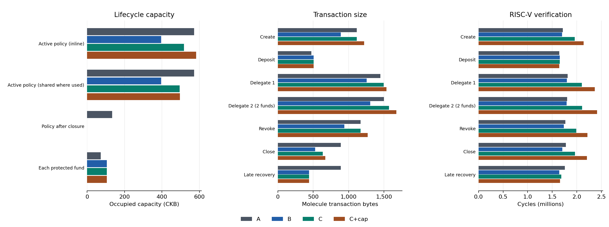

# Results

Both independent-recovery profiles released the entire policy Cell and recovered a late deposit. Their owner can also withdraw during the active phase. The original QCN4/QCT4 lifecycle retained 134 CKB and required the live terminal policy for late recovery.

The conventional profile B used fewer bytes, dependencies and cycles for delegated payments than C. Both serialise delegated spends through one policy Cell. C's benefit in this experiment was a separate payment-cap adapter that enforced a tighter ceiling and rejected its own removal while the quota policy was live. Its introduction left the quota adapter byte-for-byte unchanged.

## Capacity

| CKB | A | B | C | C+cap |
| --- | ---: | ---: | ---: | ---: |
| Active policy (inline) | 572 | 395 | 517 | 582 |
| Active policy (shared where used) | 572 | 395 | 494 | 496 |
| Policy after closure | 134 | 0 | 0 | 0 |
| Each protected fund | 73 | 105 | 105 | 105 |
| Funded active policy | 600 | 600 | 600 | 600 |
| Shared custom code, table and definition | 52,359 | 69,410 | 169,150 | 205,725 |

Each active policy was funded at 600 CKB. Closure released 466 CKB in A and 600 CKB in B and C before fees. Custom deployment costs are shared across Pockets using the same code and definitions. The optional shared-definition Cell is included for C and C+cap. Verification cycles cover the whole signed transaction. The genesis secp code, precomputation data and dep-group Cells together occupy 1,100,888 CKB, a common chain cost excluded from the custom deployment totals.

## Transactions

Each entry gives transaction bytes / witness payload bytes / verification cycles / Cell Deps / Header Deps. Dep counts are encoded transaction entries. The shared secp dep-group entry resolves to two code/data Cells. C uses an inline input and shared successor for its first payment, and the reverse for its second.

| Scenario | A | B | C | C+cap |
| --- | ---: | ---: | ---: | ---: |
| Create | 1,114 / 97 / 1,714,312 / 4 / 0 | 888 / 85 / 1,698,511 / 3 / 0 | 1,116 / 85 / 1,958,690 / 5 / 1 | 1,218 / 85 / 2,138,658 / 6 / 1 |
| Deposit | 472 / 85 / 1,644,225 / 1 / 0 | 504 / 85 / 1,653,971 / 1 / 0 | 504 / 85 / 1,652,419 / 1 / 0 | 504 / 85 / 1,641,618 / 1 / 0 |
| Delegate 1 | 1,448 / 97 / 1,811,548 / 4 / 0 | 1,254 / 85 / 1,797,875 / 3 / 0 | 1,496 / 85 / 2,103,813 / 6 / 1 | 1,535 / 85 / 2,367,773 / 7 / 1 |
| Delegate 2 (2 funds) | 1,500 / 97 / 1,804,528 / 4 / 0 | 1,306 / 85 / 1,790,575 / 3 / 0 | 1,571 / 85 / 2,108,217 / 6 / 1 | 1,673 / 85 / 2,409,937 / 7 / 1 |
| Revoke | 1,167 / 98 / 1,767,532 / 4 / 0 | 940 / 85 / 1,737,535 / 3 / 0 | 1,168 / 85 / 1,990,229 / 5 / 1 | 1,270 / 85 / 2,217,161 / 6 / 1 |
| Close | 889 / 97 / 1,775,479 / 4 / 0 | 529 / 85 / 1,703,730 / 3 / 0 | 635 / 85 / 1,960,554 / 5 / 1 | 672 / 85 / 2,205,760 / 6 / 1 |
| Late recovery | 889 / 97 / 1,755,289 / 4 / 0 | 440 / 85 / 1,643,741 / 2 / 0 | 440 / 85 / 1,683,812 / 2 / 0 | 440 / 85 / 1,659,063 / 2 / 0 |

## Verification

- **A** passed 9 committed cases and 11 expected rejections.
- **B** passed 13 committed cases and 11 expected rejections.
- **C** passed 13 committed cases and 12 expected rejections, plus 1 accepted dry run.
- **C+cap** passed 13 committed cases and 14 expected rejections, plus 1 accepted dry run.

Cases cover authenticated creation, both delegate payments, exhausted shared allowance after treasury replenishment, incorrect recipients, revocation, and aggregation of two protected fund inputs. They also cover policy duplication, identity substitution, counter reset, a stale authorisation, unauthorised retirement, owner closure and late recovery. B and C reject reclaiming delegated authority after retirement and recover malformed untyped native deposits via the owner path. In C the verifier accepts both inline and shared payment successors from the same state and rejects an incorrect recipient with either representation.

The retained-capacity result depends on independent owner authority. Strict recovery-after-closure under a zero-retained-capacity construction remains open. Measured cycles include secp verification and can vary with fresh signatures. Maximum fan-in, general asset recovery and reorganisations were outside this run.

See [raw results and exact deployed hashes](evidence/comparison.json), [first-party builds](evidence/contracts.json), [failed attempts and corrections](evidence/run-notes.md), and [reproduction commands](README.md).
